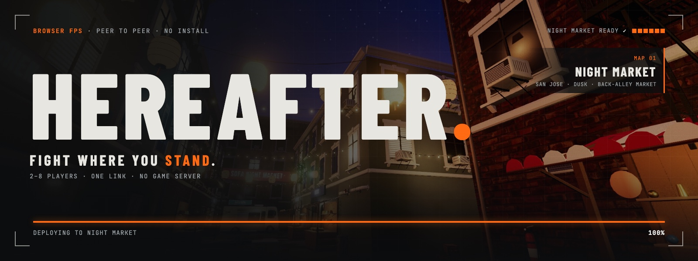
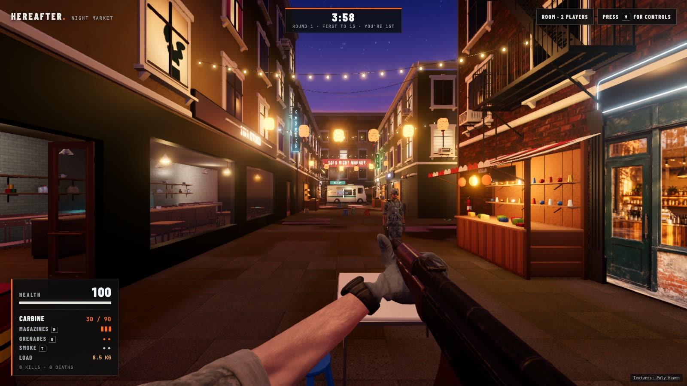
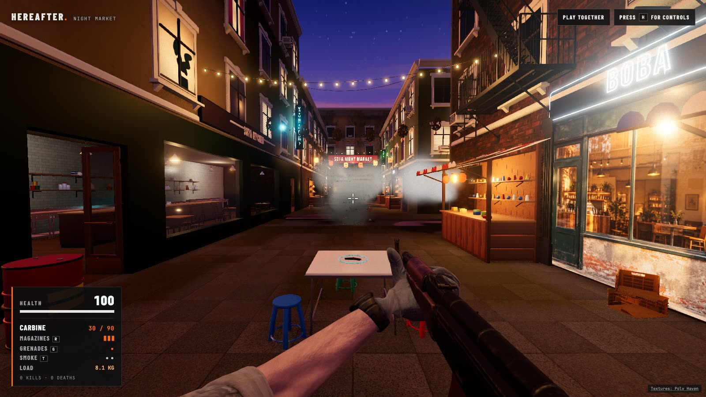
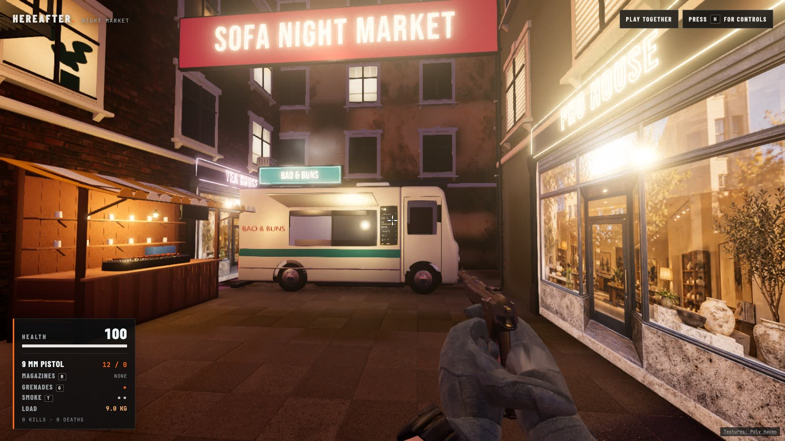
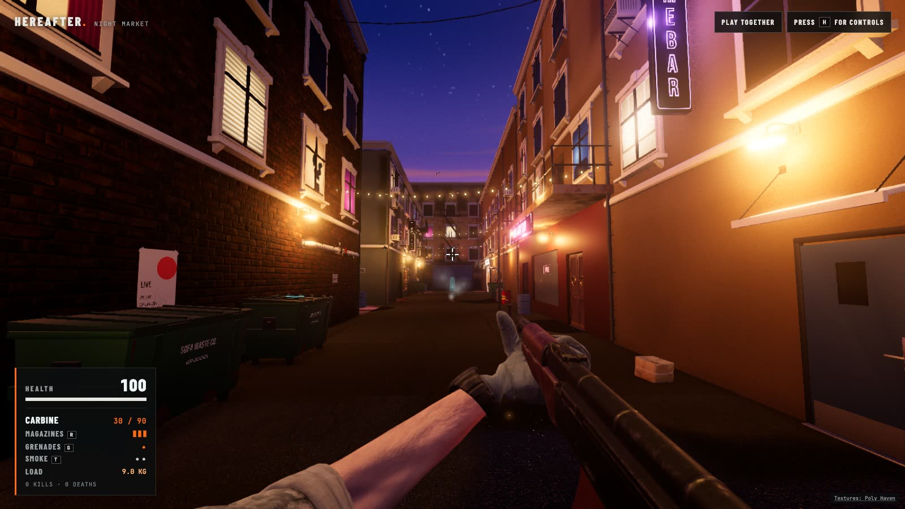
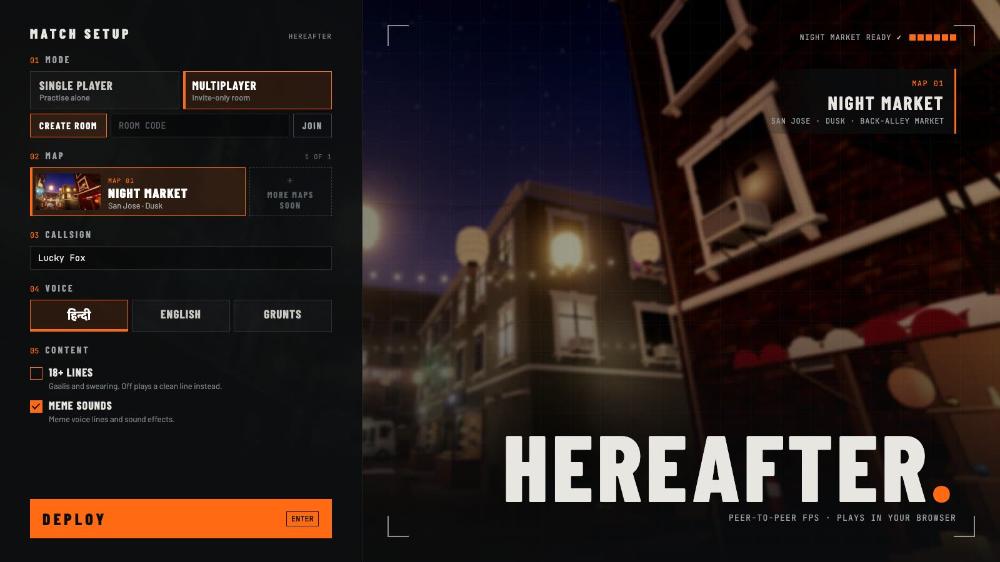
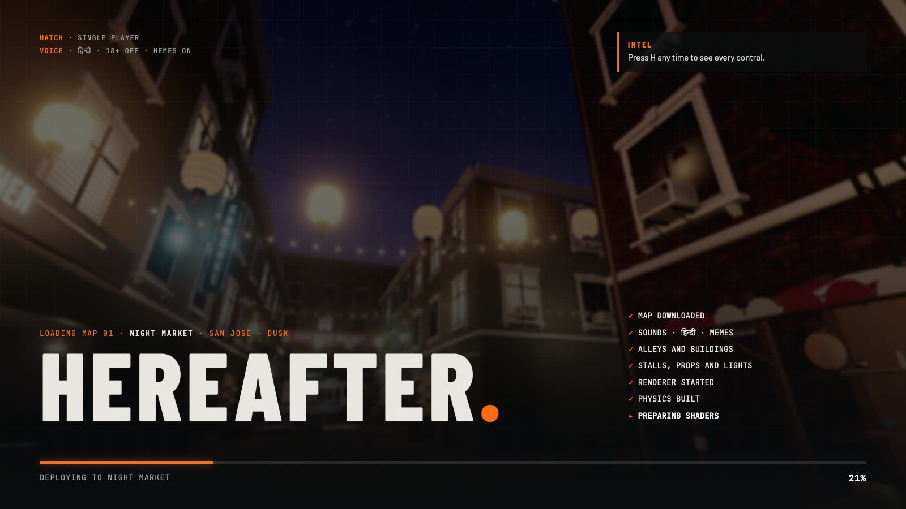
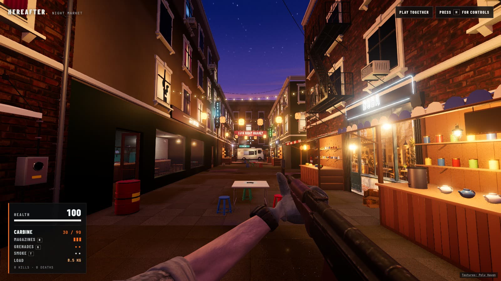

<div align="center">

<a href="https://kushagrabainsla.github.io/hereafter/"></a>

[](https://kushagrabainsla.github.io/hereafter/)

[](https://github.com/Kushagrabainsla/hereafter/actions/workflows/deploy-pages.yml)


**A multiplayer first-person shooter that runs in your browser.**<br>
Close fights in a hand-built back-alley night market, played peer to peer from a link.<br>
Nothing to install, no account, no game server.

<sub><b>01</b> <a href="#01--briefing">BRIEFING</a> &nbsp;·&nbsp; <b>02</b> <a href="#02--deploy">DEPLOY</a> &nbsp;·&nbsp; <b>03</b> <a href="#03--controls">CONTROLS</a> &nbsp;·&nbsp; <b>04</b> <a href="#04--loadout">LOADOUT</a> &nbsp;·&nbsp; <b>05</b> <a href="#05--squad-up">SQUAD UP</a> &nbsp;·&nbsp; <b>06</b> <a href="#06--build-from-source">BUILD</a> &nbsp;·&nbsp; <b>07</b> <a href="#07--intel">INTEL</a></sub>

</div>

## 01 · Briefing

> **MAP 01 · NIGHT MARKET** &nbsp;·&nbsp; San Jose, SoFA district &nbsp;·&nbsp; Dusk &nbsp;·&nbsp; 60 m of back alley

Everyone starts with a knife and a couple of grenades. Pistols, carbines and spare magazines lie around the market, and every magazine counts. Rounds punch through stalls, glass and crates. Doors come off their hinges, lights get shot out, and fuel drums explode.

It is a working prototype: the map, movement, combat, destruction, sound, rounds and peer-to-peer rooms are all playable.

<table>
  <tr>
    <td width="50%"></td>
    <td width="50%"></td>
  </tr>
  <tr>
    <td align="center"><sub><b>CONTACT</b> · another player across the stalls</sub></td>
    <td align="center"><sub><b>FRAG OUT</b> · a grenade bursting in the alley</sub></td>
  </tr>
  <tr>
    <td></td>
    <td></td>
  </tr>
  <tr>
    <td align="center"><sub><b>NORTH END</b> · the food truck under the market banner</sub></td>
    <td align="center"><sub><b>SERVICE ALLEY</b> · dumpsters and the bar's back door</sub></td>
  </tr>
</table>

## 02 · Deploy

Open the [live game](https://kushagrabainsla.github.io/hereafter/) in a desktop browser with WebGPU or WebGL 2. It opens on the match setup screen:

| # | Step | What you pick |
|---|---|---|
| **01** | **MODE** | Single player, or a room to create or join |
| **02** | **MAP** | The Night Market, with more maps to come |
| **03** | **CALLSIGN** | Your name in the kill feed and on the scoreboard |
| **04** | **LANGUAGE** | हिन्दी or English |
| **05** | **CONTENT** | Voice lines (off: only grunts and cries), 18+ lines (gaalis and swearing), and meme sounds |

The map downloads while you choose. Press **DEPLOY**: the game goes full screen and the mouse locks for mouse look, the loading screen fetches only the sounds you picked and builds the world, and you spawn at one end of an alley with a knife. Find a gun, find magazines, and stay alive. Your choices are saved for next time.

<table>
  <tr>
    <td width="50%"></td>
    <td width="50%"></td>
  </tr>
  <tr>
    <td align="center"><sub><b>MATCH SETUP</b> · the map downloads while you choose</sub></td>
    <td align="center"><sub><b>DEPLOYING</b> · only what you picked, step by step</sub></td>
  </tr>
</table>

## 03 · Controls

| Action | Keys |
|---|---|
| Move | <kbd>W</kbd> <kbd>A</kbd> <kbd>S</kbd> <kbd>D</kbd> or arrow keys |
| Run | hold <kbd>Shift</kbd> |
| Jump, or climb a ledge you face | <kbd>Space</kbd> |
| Crouch (while running: slide) | hold <kbd>C</kbd> or <kbd>Ctrl</kbd> |
| Lean | hold <kbd>Q</kbd> or <kbd>E</kbd> |
| Look | move the mouse: it locks, and the game goes full screen, when you deploy. <kbd>Esc</kbd> frees it and leaves full screen, a click brings both back; unlocked, drag to look |
| Attack, or slash with the knife | click or <kbd>F</kbd> |
| Stab with the knife | right-click or <kbd>V</kbd> |
| Aim down the sights, with a gun | hold right-click (on a Mac trackpad, press and hold with two fingers) |
| Knife, pistol, carbine | <kbd>1</kbd> <kbd>2</kbd> <kbd>3</kbd> |
| Reload | <kbd>R</kbd> |
| Pick up, eat, open doors and hatches | <kbd>E</kbd> |
| Lift what you look at, put it down | <kbd>E</kbd> |
| Throw what you carry | click, hold for more power |
| Bandage your wounds | <kbd>B</kbd> |
| Frag grenade, smoke grenade | <kbd>G</kbd>, <kbd>T</kbd> |
| Respawn, three seconds after you fall | <kbd>Enter</kbd> |
| Scoreboard | hold <kbd>Tab</kbd> |
| Mute | <kbd>M</kbd> |
| Show the controls | <kbd>H</kbd> |

## 04 · Loadout



**▸ WEAPONS**
- A field knife with two strokes. A slash sweeps across and stops at the first thing it meets. A stab lunges in for 100 to the head, and a stab in the back is fatal.
- 9 mm pistols (12 rounds) and carbines (30 rounds), found on the map. Each comes with only the magazine in it.
- Real magazines. A reload swaps in your fullest spare: a part-used one goes back in the pouch, an empty one drops to the ground. When the spares run out, the gun is empty.
- Frag grenades that bounce, roll and throw players off their feet, and smoke grenades that pour out a 7 m grey wall.
- Head, body and leg hit zones. Spread grows while moving, jumping or firing long bursts, and the crosshair shows it.
- Aim down the sights with right-click: the view zooms in, the gun steadies and spread halves, but you walk at half pace.
- Rounds penetrate by material: glass, crates, bins, cardboard, wooden stalls and bodies.

**▸ MOVEMENT**
- Run, crouch, slide, and lean around cover.
- Climb onto counters, dumpsters and ledges up to 1.6 m. Ladders lead to the fire escape and the bar's balcony.
- Everything you carry has weight, and guns and magazines slow you down. Falls from height hurt.

**▸ A MARKET THAT BREAKS**
- Stalls tear, then collapse into low cover you can climb.
- Windows shatter. Doors open, kick in, or come off their hinges.
- Every lamp and sign can be shot out. One breaker box blacks out the whole service alley.
- Steam pipes burst into cover. Fuel drums vent and explode. The food truck's propane cylinders go up.
- Walk into the dumpling shop, the boba shop and the pho house. Eat at the counter for health, or grab a boba for a burst of speed.
- Chairs, stools and tables are real objects with real weight: barge through them, knock them over or shoot them apart. Everything loose is simulated by whoever touches it, so it reacts instantly.
- Pick up anything up to 25 kg and throw it. A stool flies and a crate barely leaves your hands, a thrown chair hits like a bullet, and what hits a wall hard enough breaks.
- Use what's there. Take an extinguisher off the wall and spray a fire out, light a stove, or throw the breaker and put a whole alley in the dark.
- Make your own door. Two frags knock through the thin walls of the shops, the restaurant and the bar.
- People are in the world too: sliding crates bounce off bodies and shove them, and anyone caught in flames keeps burning until they get low or someone sprays them.
- Fire spreads. Burst a fuel drum and the flames work through wood, cardboard and plastic, setting off the next drum, until they burn out or someone shoots an extinguisher.
- Wounds last. A shot leg limps, a shot arm shakes and reloads slowly, and cuts and bullets bleed until you stop to tie a bandage.

**▸ MATCHES**
- Five-minute rounds, or first to 15 kills. The winner is shown on the scoreboard, and the next round starts 12 seconds later with the market rebuilt.
- A scoreboard on <kbd>Tab</kbd> with kills, deaths and ping, a round clock, and a kill feed naming who got whom.

**▸ COMMS**
- Players have voices: grunts and cries, and calls, taunts and banter in **Hindi or English**, with an opt-in 18+ tier of gaalis and swearing. English lines are placeholders and Hindi lines are silent until recorded; see the [recording sheet](docs/voice-lines.md).
- Meme sounds on top: a vine boom on a headshot, an air horn on a double kill, a boing on a jump, a metal pipe on a hard landing, crickets after a round with no kills, and Hindi meme clips like "Aayein?", "Are baap re, yaad aaya" and the KGF theme, with more Hindi and English meme lines to come ([list](docs/voice-lines.md#memes)). At most one per player every 30 seconds, and they can be turned off.

**▸ LOOK AND SOUND**
- Rendered with Three.js on WebGPU, falling back to WebGL 2. On WebGPU every lamp, bulb string and sign is a real light.
- The market's lamps, signs, stalls, windows, furniture and street dressing are modelled in Blender, beside scanned props from Poly Haven. Light bouncing off walls and floors is baked offline in Cycles, and wet paving reflects the lamps.
- Recorded gunshots, reloads and footsteps, placed in 3D: dulled by distance and walls, with close rounds cracking past you.
- A market that sounds alive: traffic beyond the walls, whirring air conditioners, and music thumping from the bar.

## 05 · Squad up

1. On the setup screen choose **MULTIPLAYER**, keep **CREATE ROOM** and press **DEPLOY**.
2. Press **ROOM** at the top right, copy the invite link and send it to your friends.
3. Their setup screen opens on your room; they press **DEPLOY**. Or they type in the room code and choose **JOIN**.

Once two players are in, a ten-second countdown starts the first round. Change your name, voice and sound choices under **ROOM** at any time.

- **2 to 8 players**, browser to browser over WebRTC. Rooms are found through public Nostr relays; the game itself is static files on GitHub Pages.
- **No game server.** One player's browser checks combat for the room (range, cover, ammo, timing), and that role moves to another player if they leave, crash or switch tabs. If the host's tab crashes, play carries on after about 2 seconds.
- **Fast joins.** A player opening the link downloads the map while they set up, and connects while their world is still building.
- Some networks block direct connections and would need a TURN relay, which isn't set up yet.

How it works: [multiplayer](docs/multiplayer.md). The measurements behind it: [network benchmarks](docs/network-benchmarks.md).

## 06 · Build from source

You need [Node.js](https://nodejs.org/) 22.12 or newer and a browser with WebGPU or WebGL 2.

```sh
git clone https://github.com/Kushagrabainsla/hereafter.git
cd hereafter
npm ci
npm run dev
```

Open the URL Vite prints. No API key or account is needed: every asset the game uses is in the repository.

| Command | What it does |
|---|---|
| `npm run dev` | Development server with hot reload |
| `npm run build` | Type-check and build into `dist/` |
| `npm run build:pages` | Build for GitHub Pages, under `/hereafter/` |
| `npm run preview:pages` | Serve the Pages build locally |
| `npm run build:assets` | Rebuild the modelled lamps, signs, furniture, street dressing, items, building dressing and effects, checked and compressed (needs Blender 4.4+) |
| `npm run build:textures` | Rebake the wood floor and kitchen tile textures in Blender |
| `npm run build:viewmodels` | Rebuild the first-person arms and weapons (needs Blender 4.4+) |
| `npm run build:lightmaps` | Rebake the market's light after a map change (needs Chrome and Blender) |
| `npm run build:audio` | Download and rebuild the sound effects |
| `npm run build:voices` | Rebuild the players' voices and memes from any recorded lines and added clips |
| `npm run build:memes` | Download and rebuild the meme sound effects (after `build:audio`, which fetches one of them) |

Add `?renderer=webgl` to the URL to force WebGL 2. Pushes to `main` deploy to GitHub Pages through [`deploy-pages.yml`](.github/workflows/deploy-pages.yml).

**Built with**
- [Three.js](https://threejs.org/) r186, WebGPU renderer with node materials, falling back to WebGL 2
- [Rapier](https://rapier.rs/) physics in WebAssembly, for the 60 Hz character controller, collisions, shots and ragdolls
- [Trystero](https://github.com/dmotz/trystero), for peer-to-peer rooms over WebRTC, found through Nostr relays
- [Vite](https://vite.dev/) and TypeScript
- [Blender](https://www.blender.org/), for the view models, the food truck, the wall kit, the lamps, signs, furniture, street dressing, items, building dressing and effects, the baked floor and tile textures (through the [asset pipeline](docs/asset-pipeline.md)) and the baked lightmaps

```
src/
  main.ts          the setup screen: choices, map download, Deploy
  play.ts          the game: HUD, input, rooms, voices and the loop that ties it together
  loading.ts       the loading screen and its progress
  game/            player movement, combat rules, match state, weapons, sound, voices, memes
  network/         peer room: positions, the host's updates, choosing and replacing the host
  world/           the Night Market's layout, buildings, stalls, lights, physics and renderer
scripts/           Blender and audio build scripts for the bundled assets
public/            models, textures, lightmaps, sounds and map stills shipped with the game
docs/              design and engineering notes
```

## 07 · Intel

| Note | What's in it |
|---|---|
| [The Night Market](docs/night-market.md) | The map: lanes, spawns, pickups, what breaks and how |
| [Movement](docs/movement.md) | Character controller, climbing, leaning, weight, spread |
| [Physics](docs/physics.md) | Penetration, destruction, grenades, ragdolls |
| [Rendering](docs/rendering.md) | Lighting, lightmaps, post-processing, the setup and loading screens, performance |
| [Audio](docs/audio.md) | The mix, positional sound, voices and memes |
| [Multiplayer](docs/multiplayer.md) | Rooms, the host, the protocol and its limits |
| [Network benchmarks](docs/network-benchmarks.md) | Measured traffic, delays and recovery, step by step |
| [Architecture](docs/architecture.md) | How the pieces fit |
| [Asset pipeline](docs/asset-pipeline.md) | How every model is built in Blender, checked and placed |
| [Asset sources](docs/data-sources.md) | Every model, texture, sound and font, with its license |
| [Voice lines](docs/voice-lines.md) | Every line players say, every meme, and how to record them |

## Known issues

- One map. Its layout is written in code, not built in an editor. The walls and ground are flat surfaces with photographed textures and baked light, and smoke, steam, fire, haze and tracers are particles; everything else is modelled in Blender (see the [asset pipeline](docs/asset-pipeline.md)).
- Movement comes from each player's own browser. Distance and bounds checks reject impossible moves, but a modified client could still cheat, so this isn't ready for competitive play.
- The noodle bar, the tea house and the laundry cannot be entered yet; the other shops, the restaurant and the bar can.
- No voice chat, and no computer opponents in single player yet.
- Ragdolls, spent cases and dropped magazines aren't synced between players. Destroyed objects stay destroyed until the next round.
- The view-model animations are generated from a simple motion description. There are no reload, crouch or aim-down-sights clips yet.
- The first frames build the market's shaders, which takes a few seconds on slower machines; the loading screen shows it happening.

## Credits

- Textures, props, the knife and the pistol: [Poly Haven](https://polyhaven.com/) (CC0)
- Arms and the third-person soldier: [Microsoft Rocketbox](https://github.com/microsoft/Microsoft-Rocketbox) (MIT)
- Carbine: [AKM](https://opengameart.org/content/akm) by LonesomeDucky, OpenGameArt (CC0)
- Sounds, all CC0: [The Free Firearm Sound Library](https://opengameart.org/content/the-free-firearm-sound-library), reload packs on OpenGameArt, and [Kenney](https://kenney.nl/)'s Impact Sounds and RPG Audio
- Voices: grunts and cries by HaelDB on OpenGameArt (CC0); placeholder English lines from [Piper](https://github.com/OHF-Voice/piper1-gpl) with its public-domain "norman" voice
- Meme sound effects, all CC0: [BigSoundBank](https://bigsoundbank.com/), OpenGameArt, Kenney, and instruments from [VS Chamber Orchestra Community Edition](https://github.com/sgossner/VSCO-2-CE)
- Fonts: [Barlow and Barlow Condensed](https://github.com/jpt/barlow) by Jeremy Tribby and [JetBrains Mono](https://github.com/JetBrains/JetBrainsMono), both under the SIL Open Font License

Full records, with authors and links, are in [asset sources](docs/data-sources.md).

## License

The code doesn't have a license yet. The bundled assets keep their own licenses, listed in [asset sources](docs/data-sources.md).

<div align="center"><sub><b>HEREAFTER</b> · MAP 01 · NIGHT MARKET · <a href="https://kushagrabainsla.github.io/hereafter/">DEPLOY ▸</a></sub></div>
